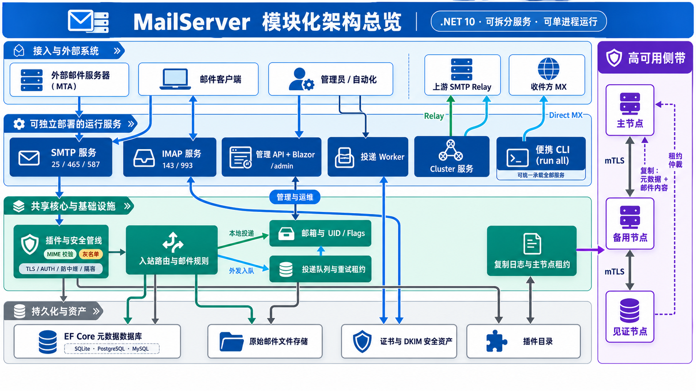
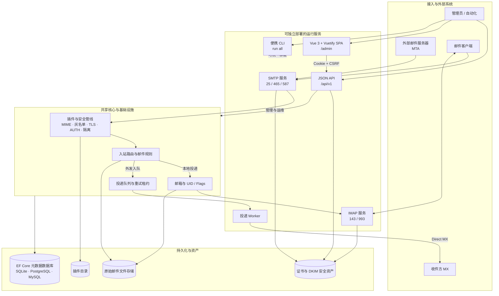

# MailServer 架构总览

MailServer 是一个面向 .NET 10 的模块化邮件服务器。SMTP、IMAP、JSON API、Vue/Vuetify 管理端和 Direct MX Worker 可以拆分部署，也可以由便携 CLI 通过 `run all` 在单进程中统一运行。

> 下图是基于信息图模板生成的展示视觉稿；工程关系与箭头以其后的 Mermaid 逻辑架构为准。

## 逻辑架构

## 关键链路

1. **收信与取信**：外部 MTA 或已认证客户端连接 SMTP，邮件通过插件和安全策略后进入统一入站路由；本地收件写入邮箱，客户端通过 IMAP 读取。
2. **外发投递**：外部收件进入投递队列，Worker 取得重试租约后查询收件方 MX，通过多 MX/IP 故障转移、TLS 策略和退避重试完成投递。
3. **管理与运维**：Vue SPA 只负责界面并通过同源 JSON API 操作；API 与 CLI 复用共享基础设施，管理域名、账号、队列、证书、插件、审计和计划任务。
4. **数据持久化**：关系数据库保存元数据、配置、队列和审计；原始邮件内容单独存放在文件存储中；证书、DKIM 私钥和插件包使用独立资产目录。

## 部署形态

- **拆分部署**：分别运行 API、SMTP、IMAP 和 Worker 服务，适合生产环境与独立扩缩容。
- **便携单进程**：通过 CLI 的 `run all` 统一加载协议服务、管理端、投递和维护后台任务，适合单机或轻量部署。
