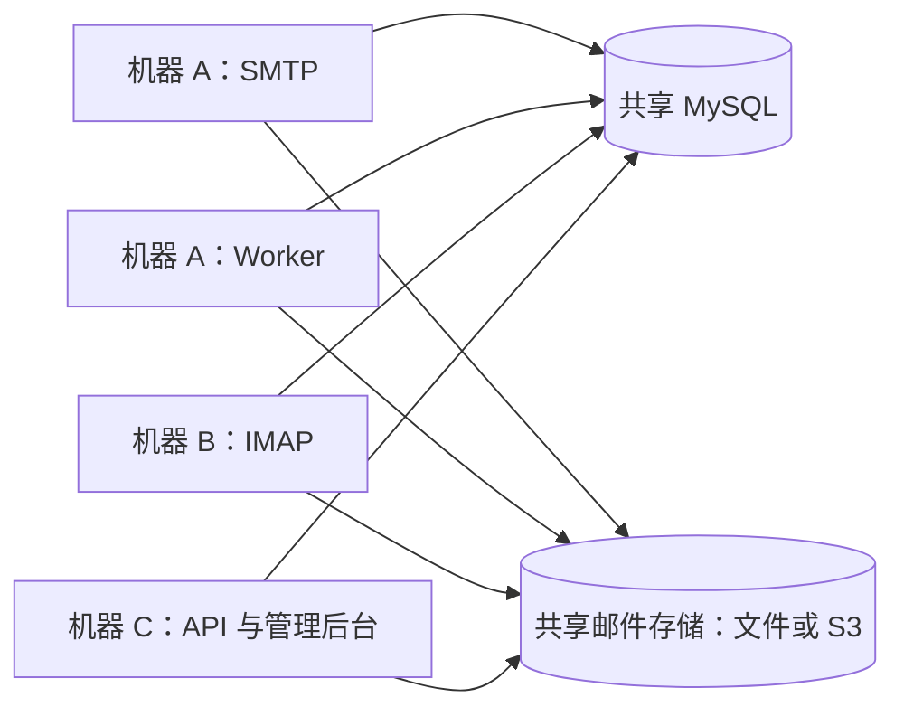

# SMTP、IMAP、API 分机部署

本版本支持按进程角色拆分、共享文件目录与 S3 兼容对象存储两种邮件后端、节点独立资源配置，以及 API 汇总节点状态。默认仍为本地文件后端，现有单机配置无需切换。

## 服务分配

三台机器时，A 运行 SMTP 和 Worker，B 运行 IMAP，C 运行 API；两台机器时可以将 API 与 SMTP / Worker 放在一起。Worker 负责外发、已发送副本和定时维护，不能漏掉。每个角色是独立进程，可以按实际负载单独扩容。



所有角色使用同一个 MySQL 业务库和同一套邮件内容。禁止把 SQLite 业务库放进网络共享目录来替代 MySQL。数据库连接池按所有进程相加规划；`Database:ContextPoolSize` 仅限制空闲 EF 上下文，不限制实际数据库连接数。

## 每个进程的配置

将以下配置合并到已有配置文件，保留域名、监听端口、TLS 等实际设置。数据库密码用环境变量 `ConnectionStrings__MailDatabase` 提供。

```json
{
  "Database": { "Provider": "MySql", "ContextPoolSize": 16 },
  "Node": {
    "Enabled": true,
    "Id": "smtp-a",
    "ResourceProfile": "1gb",
    "CacheBytes": 8388608,
    "HeartbeatSeconds": 15,
    "StaleSeconds": 60
  },
  "Snowflake": { "MachineId": 1, "StateDirectory": "/var/lib/mailserver/smtp/snowflake" },
  "LocalLogs": { "Path": "/var/lib/mailserver/smtp/logs.db" },
  "BackgroundServices": { "ProcessWakeEnabled": false }
}
```

`Node:Id` 是显示名称，同机各角色可以使用相同机器名称，也可以使用 `smtp-a`、`worker-a` 等独立名称。`Snowflake:MachineId` 则必须按机器唯一分配 0–127；同机进程默认按角色分配 `ProcessSlot`。同机同角色多副本必须显式分配不同的 0–7 槽位。雪花状态目录必须持久化，不能在重启时删除。节点模式未配置 MachineId 会拒绝启动。

节点模式下，`Node:ResourceProfile` 覆盖全局档位；省略则跟随全局档位，无全局设置时使用 `1gb`。`Node:CacheBytes`、`DeliveryConcurrency`、`SmtpConnections`、`ImapConnections` 可以单独覆盖。预算属于当前进程，不再按 SMTP 50%、IMAP / Worker 25% 分摊。协议连接仍受原有协议配置和内存保护上限约束。

例如 SMTP 配 8 MiB、IMAP 配 16 MiB、API 配 2 MiB、Worker 配 8 MiB，总计是 34 MiB 的受控缓存额度。API 的额度用于诊断缓冲，仍不保留邮件配置快照缓存。预算不是进程内存硬限制；连接、TLS、MIME 解析和运行时另占内存。节点本地参数修改后重启；未覆盖的全局参数仍自动刷新。节点模式与实验性 `AdaptiveResources:Enabled` 互斥，以免实验控制器覆盖节点上限。

分别启动：

```bash
./mailserver run smtp --config /etc/mailserver/smtp.json
./mailserver run worker --config /etc/mailserver/worker.json
./mailserver run imap --config /etc/mailserver/imap.json
./mailserver run api --config /etc/mailserver/api.json
```

每个进程配置独立的本机日志与临时目录。不同机器的内容键始终指向同一份原文，不能各自使用空的本地 `data/messages`。

## 第一步：共享文件目录

在每台机器相同路径挂载同一份持久化存储，例如 `/srv/mail/messages`，并在**已挂载的存储中**创建 `.mailstore-mounted` 文件：

```json
{
  "Storage": {
    "Provider": "File",
    "RootPath": "/srv/mail/messages",
    "RequireExistingRoot": true,
    "RequiredMarkerFile": ".mailstore-mounted",
    "MaximumMessageBytes": 52428800
  }
}
```

根目录或标记消失时，读写与健康检查失败，避免挂载失效后把邮件写进另一份本机目录。不要在未挂载的空目录里创建标记。服务启动可配置 systemd 的 `RequiresMountsFor=/srv/mail/messages`，目录权限只授予邮件服务用户。

文件通过临时文件写入、刷新和同目录树重命名发布；MySQL 按内容键协调发布与删除。共享存储需支持这些文件语义，持久性仍取决于挂载参数和存储服务。启用 `PreparedInboundEnabled` 时沿用已有的同设备移动路径；跨设备使用复制路径。

维护扫描每次只保留一页候选项，不再加载全部引用键；文件后端仍需遍历目录筛选下一页，大规模存储的扫描耗时需按实际数据量评估。

## 第二步：S3 兼容对象存储

预先创建专用 bucket，所有节点使用相同 Bucket、Prefix、Region 和服务端点。以 IMAP 进程为例：

```json
{
  "Storage": {
    "Provider": "S3",
    "MaximumMessageBytes": 52428800,
    "InboundTemporaryPath": "/var/lib/mailserver/imap/inbound",
    "S3": {
      "ServiceUrl": "https://objects.example.com",
      "Region": "us-east-1",
      "Bucket": "mail-content",
      "Prefix": "mailserver/",
      "ForcePathStyle": true,
      "CachePath": "/var/cache/mailserver/imap",
      "CacheBytes": 268435456,
      "MaximumConcurrentTransfers": 2,
      "MaximumOpenReaders": 16,
      "RequestTimeoutSeconds": 120
    }
  }
}
```

AWS S3 可省略 ServiceUrl，按实际区域设置 Region，并通常使用 `ForcePathStyle=false`。凭据优先使用 SDK 默认凭据链；也可通过 `Storage__S3__AccessKey`、`Storage__S3__SecretKey` 和可选 `Storage__S3__SessionToken` 注入。避免将正式密钥写入仓库。应用需要读、写、列出和删除自身前缀下对象的权限；不会自动创建生产 bucket。

正文仍以 SHA-256 内容键定位，格式为 `<prefix>/<前两位>/<次两位>/<hash>.eml`。上传按块落本地临时文件计算哈希，远端 PUT 成功后才返回；下载按块落盘并校验哈希，向 MIME/IMAP 返回可定位的文件流，不把整封邮件留在托管内存中。临时文件只是暂存，不构成离线收信队列；对象存储不可用时不会把本地暂存当成已成功持久化。

每个进程使用独立 CachePath，目录锁会拒绝两个进程共用缓存。CacheBytes 是**磁盘保留缓存**，独立于 Node 的内存缓存预算。缓存命中仍检查远端对象存在；远端不可用时不会返回旧缓存。超过缓存预算的正文用临时文件读取，关闭流时删除。

下载/上传受 MaximumConcurrentTransfers 控制，打开的正文流受 MaximumOpenReaders 控制。保留缓存外还需给活跃读取和上传暂存预留磁盘；保守上限为 `CacheBytes + (MaximumOpenReaders + MaximumConcurrentTransfers) × MaximumMessageBytes`，另计文件系统元数据、SMTP 入站暂存等。按默认值约需 1.13 GiB；低磁盘节点可降低读流上限和最大邮件大小。读取结束必须释放流，程序内的调用沿用原有释放模式。

对象清理通过分页枚举和 MySQL 引用检查进行。新发布内容至少保留五分钟，孤儿扫描另受保留天数限制；业务引用提交必须在该保护窗口内结束。数据库和对象存储不具备跨系统原子事务，异常中断可能留下稍后清理的孤儿对象。不要给当前邮件前缀设置独立于数据库引用的自动过期规则。

**切换 Provider 不会搬迁旧邮件。** 已有文件部署应停写、按原内容键将 `.eml` 上传到目标前缀、验证大小及哈希，再统一切换所有角色；迁移核验完成前保留旧存储。此版本增加后端能力，不包含自动迁移工具。

## 节点状态与分布式边界

API 新增 `GET /api/v1/settings/nodes`，需要 `settings.read` 权限。返回节点、角色、进程实例、心跳时间、在线/离线/失败状态、工作集内存、托管堆、实际资源限制及存储类型，不返回凭据。复用现有 `configuration_process_statuses` 表，无新增数据库迁移。默认 15 秒心跳，超过 60 秒标记离线，API 清理七天前的历史实例。

现有 `/api/v1/settings/resources/status` 在节点模式下汇总这些心跳，离线实例不计入在线缓存合计。心跳在线表示进程仍在上报，不代表远端存储健康；`/api/v1/health/ready` 会实际检查 API 所用的存储。S3 检查包含写、读、删一个专用临时探针。

跨机通知本轮继续依赖数据库轮询。节点模式默认关闭本机命名管道通知；已有配置显式设置 true 时需改为 false。IMAP IDLE 默认最多等待约 `Imap:IdlePollSeconds=15` 秒，Worker 默认轮询 `Delivery:PollIntervalSeconds=5` 秒。缩短间隔可降低延迟，但会增加数据库查询。本轮没有新增消息代理。

邮件 S3 后端仅处理原文。证书、DKIM 私钥和 Data Protection 密钥仍由 `SecurityAssets:RootPath` 管理，需要在相关机器上使用一致路径的共享目录或外部部署分发；本轮不自动同步。日志仍是各节点本机 SQLite，API 未新增跨机日志检索。扩容前分别安排这些文件的访问、备份和轮换。

## Linux 验证

普通回归（不运行性能基线）：

```bash
dotnet test tests/MailServer.Tests/MailServer.Tests.csproj -c Release \
  -p:SkipAdminBuild=true --filter 'FullyQualifiedName!~Benchmark'
```

真实 MySQL + MinIO 联调：

```bash
bash scripts/test-distributed-storage.sh
```

脚本创建专用 Docker 网络、MySQL、MinIO 和 SDK 容器，不对宿主开放端口，退出时移除自己的容器、网络与构建卷。它测试不同存储实例上传、并发同键写入、独立缓存读取、远端删除、分页与健康检查；仅使用测试凭据。可用 MYSQL_TEST_IMAGE、S3_TEST_IMAGE、DOTNET_TEST_IMAGE 指定可访问的镜像。普通测试会明确跳过需要这些服务的联调用例，不能将模拟测试通过视为实库联调通过。

2026-10-24 本次验证：WSL Ubuntu 26.04 中使用 .NET 10 SDK 容器，非 Benchmark 回归 518 项通过，1 项真实 S3 / MySQL 联调明确跳过。专项模拟测试覆盖共享挂载、存储分页、引用保护、S3 缓存/大小/哈希/并发读取限制，以及节点预算和离线状态。MySQL / MinIO 镜像获取遇到超时、连接重置或鉴权失败，未完成真实服务联调；未运行性能基线，也不据此承诺内存下降比例或吞吐提升幅度。
