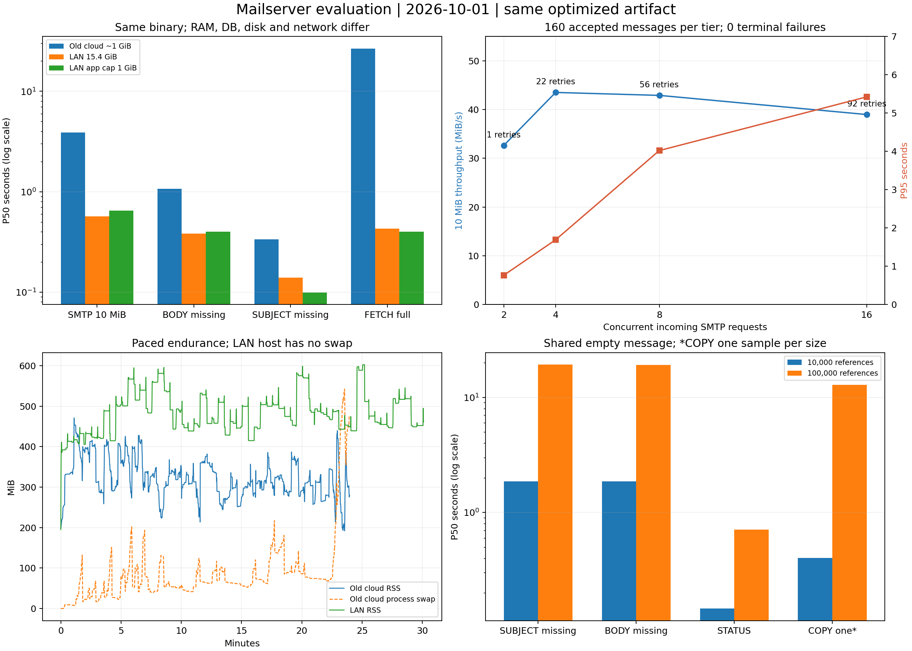

# 大内存部署与效率综合评估

记录时间：2026-10-01 02:51:08（Asia/Shanghai）。

本轮部署了上一轮最终优化版的同一份 Release 程序和 Portable PDB，在新机器执行真实 SMTP 收信、IMAP 搜索与下载、100 个 IDLE 订阅者、1 万／10 万封邮箱，以及超过 30 分钟持续负载。结论是：**更充裕的内存和本地数据库明显改善现有部署表现，但下一步主要应解决写入锁竞争、整箱数据读取及 MIME 临时分配。按内存容量直接提高活跃任务数，会放大等待和重试。**

本轮是评估与部署，没有修改应用业务代码。下一轮应按本文优先级分别实现和验证，不能把本轮环境收益计为新的代码优化收益。

## 1. 环境、版本与比较范围

| 项目 | 上一轮云主机 | 本轮局域网主机 |
| --- | --- | --- |
| 内存 | 887.1 MiB，约 1 GB 场景 | 15.37 GiB，约 16 GB，实际不是 32 GB |
| CPU | 2 vCPU | Intel N100，4 核／4 线程 |
| Swap | 2 GiB | 未配置 Swap |
| 数据库 | Azure MySQL 8.4.9-azure，跨主机访问 | 本机 Docker MySQL 8.4.3，127.0.0.1:3306 |
| 邮件存储 | 上轮云主机存储 | /mnt/storage，Kingchuxing 1 TB SATA SSD，ext4 |
| MySQL 数据／系统盘 | 云主机及云数据库 | NVMe 系统盘；与邮件存储不同设备 |
| 其他负载 | 上轮环境 | 保留原有 Docker 和系统服务，是共享机器 |

部署位置 `/mnt/storage/mailserver`，服务 `mailserver-evaluation.service` 已启用并运行。管理入口为 `https://192.168.2.8:5000`；证书为本轮自签名证书。SMTP 25、Submission 587、IMAPS 993 已添加仅允许 `192.168.0.0/16` 的 UFW 规则；没有开放到任意公网来源。

程序 SHA256：`6a8672aa33761e602b717a1128c21eaf673e6772c9a95254d2b94ab8fafa4df0`。部署包含 10 个匹配的 PDB。工作区 HEAD 为 `cac55ff2e86adc9e808fea65143c17a085d6097b`；原有未提交修改保留。基线采用上轮已验证产物，未重新构建或替换为另一版源码。

正式测量关闭应用性能采集及 EfficiencyDiagnostics；采用 dotnet-trace、dotnet-counters、PerfView、进程／cgroup／磁盘计数和 MySQL performance_schema。管理 API 仅用于设置、认证及健康检查，没有用诊断 API 获取性能数据。MySQL buffer pool 保持 128 MiB，`innodb_flush_log_at_trx_commit=1`、`sync_binlog=1`，没有放宽持久化保证。

**比较限制：**CPU、数据库距离与版本、磁盘、网络、其他服务均不同，因此本轮不能算作仅改变内存的严格 A/B。新机器上额外做了应用 1 GiB cgroup 上限短测，但 MySQL、其他服务和已有文件缓存位于该上限之外，这也不是整机 1 GB 复现。

上轮完整报告：[runtime-efficiency-iteration-003257](2026-10-01-runtime-efficiency-iteration-003257.md)。本轮原始数据在 [lan-20261001](../../builds/performance/lan-20261001/)，汇总在 [assessment-evidence.json](../../builds/performance/lan-20261001/assessment-evidence.json)。文件不包含访问密码或 SSH 私钥。

## 2. 同一程序跨环境的协议延迟

固定 INBOX 包含 6 封邮件，包括 2×1 MiB、2×10 MiB、Unicode 和空正文；完整下载共 24,086,070 字节。新收信进入独立负载邮箱，不改变这个固定搜索／下载数据集。下表为各场景 5 轮 P50，单位秒；SMTP 每种尺寸共 20 个样本，搜索／下载每项 5 个样本。

| 操作 | 上轮约 1 GB 云主机 | 本轮大内存、同类运行顺序 | 本轮应用限 1 GiB |
| --- | ---: | ---: | ---: |
| SMTP 收信 1 MiB | 2.037 | 0.407 | 0.438 |
| SMTP 收信 10 MiB | 3.902 | 0.568 | 0.647 |
| SUBJECT 无匹配 | 0.336 | 0.140 | 0.100 |
| SUBJECT 编码头 resume | 0.276 | 0.123 | 0.111 |
| BODY 尾部匹配 | 1.872 | 0.402 | 0.403 |
| BODY 无匹配 | 1.074 | 0.382 | 0.400 |
| FETCH HEADER | 0.460 | 0.107 | 0.026 |
| FETCH 全文 | 26.617 | 0.428 | 0.401 |

全文下载在本轮应用被限为 1 GiB 时仍约 0.4 秒，因此上轮 26.6 秒不能简单解释为应用内存不足。局域网、本地数据库、缓存与存储差异共同影响结果；不能据此精确分摊各因素贡献。短测未发生 OOM，不能替代整机小内存的 30 分钟验收。

在新机器额外使用专门预热，交替运行已有搜索优化开／关各 5 轮，采用相同 1gb 资源软配置。开启后的 BODY 尾部／无匹配 P50 从 0.598／0.603 秒降至 0.353／0.395 秒；SUBJECT 无匹配从 0.126 秒降至 0.066 秒。SMTP 1 MiB P50 则从 0.403 秒变为 0.453 秒，样本与背景波动不足以证明全路径均无超过 5% 的退化，**不宣称总体验收通过**。既有优化对搜索的价值仍可观察到。

## 3. 收信容量：锁竞争比加并发更值得解决

正式容量阶梯采用大内存配置，临时放宽连接频率限制，保留邮件持久化、配额和事务保护。每档 5 轮，每轮 16 封 1 MiB 加 16 封 10 MiB，合计 160 封，全部成功。下面吞吐为每轮 10 MiB 阶段的 MiB/s 中位数，延迟来自该尺寸 80 个样本。

| 并发收信请求 | 10 MiB 吞吐 MiB/s | P50 秒 | P95 秒 | 本档事务冲突重试事件 |
| --- | ---: | ---: | ---: | ---: |
| 2 | 32.63 | 0.565 | 0.765 | 1 |
| 4 | 43.50 | 0.779 | 1.691 | 22 |
| 8 | 42.90 | 1.111 | 4.019 | 56 |
| 16 | 38.97 | 2.822 | 5.420 | 92 |

重试次数是日志事件数，不是失败邮件数，也不是“发生过重试的不同邮件数”。各档按时间窗从服务日志提取；全轮包含预试验合计 584 次冲突重试，MySQL 该账户的 `ER_LOCK_DEADLOCK`（1213）也记录 584 次，证明确实发生数据库死锁。账户 UsedBytes 更新和账户读取是有错误的主要语句；事务回滚后的 savepoint 错误不能再当成独立收信失败重复计数。

当前 `InboundMessageService.AcceptAsync` 使用 Serializable 事务，先读取配额相关账户／域，再更新用量、邮箱和其他记录，最多重试 8 次。同账户并发接收容易竞争相同数据。**应优先统一账户、域、邮箱的锁定顺序，减少事务内工作，并评估有原子条件检查的配额预留。**保留严格配额、UID／ModSeq、账本幂等和提交后通知；不通过降低隔离级别、增加重试上限或抹掉等待时间来宣称提速。

容量阶梯期间服务平均 CPU 约为单核的 101%～121%，并非四核全满。MySQL 总体 CPU、主机 I/O wait 随并发有所增长，但包含其他服务，尚不足以认定唯一硬件瓶颈。补充测量的压测客户端 10 MiB 阶段 CPU／wall 约占一个核心的 43%～45%，未呈现持续单核满载；仍应以另一台独立负载发生器复验，不能把 43.5 MiB/s 当成服务绝对上限。

## 4. 大邮箱：预解析完成后仍存在查询与整箱处理瓶颈

本轮通过真实 IMAP COPY 建立 1 万和 10 万条邮箱记录。它们复用同一封空正文 fixture 和完整检索记录，验证邮箱记录数／查询成本，**不是 10 万封不同复杂邮件**，会低估独立正文、附件和索引传输的实际成本。每项 SEARCH／STATUS 测 5 次；单封 COPY 每档仅测一次。

| 操作 | 1 万条：P50 秒 | 10 万条：P50 秒 |
| --- | ---: | ---: |
| SUBJECT 无匹配 | 1.857 | 19.227 |
| BODY 无匹配 | 1.859 | 19.115 |
| UNSEEN | 0.131 | 0.736 |
| STATUS | 0.146 | 0.709 |
| COPY 单封：单次 | 0.404 | 12.853 |

单封 COPY 的数据库快照对比显示：源查询返回行数分别增加 **10,000 和 100,000**。源码 `MailboxService.CopyAsync` 先加载整箱、Include Message、排序并跟踪，再在应用中选目标邮件。该行为比泛泛增加缓存更值得先改：将 UID／区间选择下推，序号操作保留正确的序号映射，投影并仅跟踪实际变更对象；仍在既有事务中保持归属、软删除、配额和 COPY/MOVE 原子性。

SEARCH 即使共享空正文且完整索引已就绪，10 万条仍需约 19 秒。现路径每 32 条先查邮箱到 MessageId 映射，再取检索记录；邮箱快照也需要分批读取并序列化到临时文件。建议让紧凑快照携带 MessageId，去掉重复映射查询，针对 SUBJECT／HEADER 只投影必要字段，并减少快照中间序列化。必须继续去重共享 MessageId，避免 COPY 场景反复传输同一大索引；不能简单用 JOIN 取回每条完整正文。保留大小写、Unicode 子串语义和不完整索引的原文回退。

持久 IMAP 连接专项测试将 TLS／登录／SELECT 排除在操作计时外，各档 BODY 查询 80 个样本：

| 同时 BODY 查询 | 吞吐 次/s | P50 秒 | P95 秒 |
| --- | ---: | ---: | ---: |
| 1 | 4.20 | 0.230 | 0.318 |
| 2 | 7.08 | 0.279 | 0.310 |
| 4 | 10.43 | 0.388 | 0.422 |
| 8 | 11.76 | 0.574 | 0.900 |

4 到 8 并发的吞吐增益有限，尾延迟明显上升。连接数和活跃正文解码任务数应独立管理。另有每次新建连接的 IMAP 测试保存在原始数据中，不能混作纯搜索吞吐。

## 5. 运行时诊断：临时分配与重复写入仍未解决

相同单轮混合 workload 的运行时分配，上轮约 469.1 MiB，本轮 **470.4 MiB**，基本相同；本轮 Byte[] 约 235.4 MiB、String 约 190.2 MiB。新机器请求更快，不意味着单次内存成本已经降低。源码和堆栈仍指向 BODY 文本提取、规范化和 MIME 序列化。PerfView 的 evented／sampled-thread-time 权重包含等待，本文没有把这些权重当 CPU 百分比。

追加 ENVELOPE／BODYSTRUCTURE 的诊断窗口与相同 5 轮、预热但没有结构 FETCH 的窗口，累计分配分别约 **3,995.6 MiB 与 2,597.0 MiB**，差值 1,398.6 MiB。额外包含 6 次结构 FETCH（含预热），按次数粗分约 233 MiB／次。两个窗口分别重启且没有交替重复，因此这是定位证据，不是严格组件因果计量或 P95 验收。

`ImapServer.BuildBodyStructure` 对实体执行 `WriteEntityBytes`；文本分支再次序列化，并通过 MemoryStream→ToArray 和正文数组计数字节／行数。建议改为计数流或一次有界遍历，避免为长度和行数生成完整数组；ENVELOPE／HEADER 类请求评估只解析需要的头。保持 MIME 编码后的字节长度、行数、边界及协议格式一致。普通完整 FETCH 已使用流式 literal，不能把结构 FETCH 的问题误报成所有下载都完整缓冲。

30 分钟持续负载期间，服务进程 `write_bytes` 增长 **5,636,026,368 字节（5,374.9 MiB）**，输入邮件名义体量约 2,684 MiB，仍接近两倍；上轮也约两倍。SMTP DATA 临时文件位于 `/tmp` 的 NVMe 文件系统，最终邮件位于 `/mnt/storage` 的 SATA 文件系统，跨设备无法直接原子重命名。可先提供存储卷上的可配置入站暂存目录，再将 DATA 同步计算 hash 与安全移交临时文件所有权结合，允许同盘原子落库文件；保留跨设备复制兜底和异常清理。仅把临时目录移到同盘不会自动消除现有复制代码，必须实际测量物理写入和持久化保证。

长测服务 `read_bytes` 增量为 0，上轮约 6.66 GiB，说明新机器的文件缓存参与了收益；这个进程指标不包括 MySQL 读取及所有主机读盘，不能说整机没有 I/O。

## 6. 持续负载、内存和 IDLE

本轮持续负载 **1,807.61 秒（30.13 分钟）**，61 轮；每轮 8 封邮件、4 次搜索、2 次 FETCH、1 次健康检查，约每 30 秒一轮。这是有节奏的稳定性测试，**不是连续 30 分钟饱和容量测试**。

| 指标 | 上轮 | 本轮 |
| --- | ---: | ---: |
| 持续时间 | 24.05 分钟，触及 Swap 停止阈值 | 30.13 分钟完成 |
| 成功收信 | 336 | 488 |
| 搜索／FETCH／健康检查 | 168／84／42 | 244／122／61 |
| 本轮收信错误 | — | 0 |
| 进程 RSS 采样峰值 | 本轮重算约 471 MiB | 602.6 MiB |
| 进程 Swap 峰值 | 542.3 MiB | 0，主机本来未配置 Swap |
| 整机可用内存最低值 | 166.3 MiB | 10,247.8 MiB |
| 完整下载累计 | 1,011,614,940 B | 1,469,250,270 B |

上轮原报告的峰值口径略有不同；图与本表采用两轮 memory.jsonl 的 alive 样本重算。1 秒采样可能错过短峰值。本轮没有 OOM、服务重启或健康失败。P95：10 MiB 收信 1.035 秒，BODY 无匹配 0.370 秒，全文 FETCH 0.628 秒。

长测运行时计数窗口约 29 分钟，累计分配约 23.8 GiB，GC 暂停累计 4.089 秒；GC committed 峰值 365.9 MiB、最后一次约 193.4 MiB，LOH 峰值 235.7 MiB、最后约 146.3 MiB。cgroup 总内存峰值约 3,170 MiB，memory.stat 显示主要增长是约 2.6 GiB 文件缓存，不能把它当成托管堆泄漏，也不能与 RSS 相加计算内存需求。

负载结束后采集 gcdump，图中对象合计 **17,795,907 字节（约 17 MiB）**，与上轮结束后约 17 MiB 接近，支持“临时分配／提交内存与缓存是主要压力”的判断，但一次短负载不能证明长期无泄漏。gcdump 会触发 Gen2 完整 GC，因此该快照不能与运行中未回收堆直接比较，也不能把人为 GC 后的下降当成优化收益。[Microsoft dotnet-gcdump 文档](https://learn.microsoft.com/en-us/dotnet/core/diagnostics/dotnet-gcdump)

同邮箱 IDLE：1 个订阅者观察 35.40 秒，100 个订阅者观察 35.71 秒，邮箱消息 COUNT SQL 均为 **4 次**；APPEND 后 100/100 收到变更，最大约 0.608 秒，该时间包含写入连接登录和 APPEND。共享刷新已达到不随连接数线性放大的目标，暂不优先重做协调器；这不是完整断线／重连故障矩阵。

## 7. 综合优化顺序与下一轮验收

| 优先级 | 方向 | 直接证据 | 下一轮重点验证 |
| --- | --- | --- | --- |
| P0 | 收信锁顺序、事务长度、原子配额预留 | 同体量重试 1→22→56→92，并发 16 吞吐反降 | 同账户／不同账户／共享域并发；实际 MySQL 死锁数、P95、吞吐；配额精确、UID、账本幂等与失败回滚 |
| P0 | COPY/MOVE 仅查询和跟踪目标邮件 | COPY 单封读取 10 万行，耗时 12.85 秒 | SQLite＋MySQL，1k／10k／100k 单封和区间 COPY/MOVE，软删除、权限、配额、序号与原子性 |
| P1 | 紧凑搜索快照、复用 MessageId、最小字段投影 | 完整索引且空正文的 100k 搜索仍约 19 秒 | SQL 次数、返回字节、原文打开次数；共享与不同内容两种数据集，Unicode／编码头／截断回退正确 |
| P1 | BODY 文本及结构 FETCH 减少数组／字符串生成 | 单轮约 470 MiB 分配；结构诊断增加约 1.4 GiB | AllocationTick＋计数器、LOH／GC、协议字节／行数一致；1／10 MiB＋附件和 multipart |
| P1 | 入站同盘暂存与文件所有权移交 | 进程写入接近邮件输入两倍；当前暂存和存储不同设备 | 物理写入量、落盘故障、跨设备兜底、DKIM 原文与清理；不能只看吞吐 |
| P2 | 活跃任务按 CPU／I/O／内存成本预算 | BODY 4→8 尾延迟翻倍；16 GB 配置过高的活跃任务数无收益 | 混合收信＋BODY＋FETCH＋补建负载，连接数与重操作额度分离；恢复整机约 1 GB 的 30 分钟验证 |
| P2 | 后台补建游标／待处理队列、合并低价值轮询 | 查询规模扩大后扫描与往返成本更值得关注 | 先 EXPLAIN 和空闲 SQL 统计，幂等、重启续作、漏通知兜底；没有证据前不盲目加索引 |

大内存机器优先消除锁竞争和 O(N) 读取；小内存机器优先减少临时分配／重复写入并限制同时进行的重操作，两者使用同一代码路径、不同预算。保留正常频率限制，不把连接保护放宽作为生产优化。

如后续评估 GC heap hard limit，需要给原生内存、线程、缓冲和文件缓存留空间，并测试吞吐与 GC 的取舍；它控制托管堆提交预算，不等于整个进程或整机内存限制，当前没有设置新的 GC 参数。[Microsoft GC 运行时配置](https://learn.microsoft.com/en-us/dotnet/core/runtime-config/garbage-collector)

Direct MX 连接池、本轮未覆盖的外部 MX／TLS／DKIM 跨能力回退及发送结果不明场景，不能靠本地收信成绩验收；连接复用继续默认关闭。上一轮同产物的 431 项回归证据仍可引用，本轮没有重新运行整套 SQLite／MySQL／DKIM／SRS 回归，下一轮业务代码更改后必须执行相关真实数据库与协议回归。

## 8. 最终部署状态、数据质量及复现

压测结束后删除本轮生成的 **2,359 封存储邮件、102,360 条邮箱引用及对应文件／检索数据**，通过账本写入配额释放，账户用量归零；临时大邮箱和 IDLE 邮箱已删除。部署、账号和必要配置保留，审计／配额账本及预试验采集历史保留，没有清理无关服务。最终健康检查四项 ready，服务 active。

最终资源配置是 16gb 档的自定义值：缓存 128 MiB、单条 16 MiB、活跃投递／入站处理额度 4、SMTP 连接上限 128、IMAP 256、重内容加载并发 2。它是保守起点，不是已经证明的全场景最佳值。正常保护恢复：SMTP 120 次／分、burst 30、同源连接 16；IMAP 60 次／分、burst 20、同源连接 20。恢复 cgroup 无固定内存上限；性能采集和连接复用关闭。

可回退为已有 1gb 资源档，不需要回退数据库结构；本轮没有新增迁移或改动业务算法。管理凭据仅放在本地受限文件 `builds/private/lan-evaluation-credentials.json`，没有写进报告。

远端评估工作目录内的临时凭据文件和初始化日志已移除。本地本轮临时 SSH 密钥 `C:\Users\zjb23\AppData\Local\Temp\mailserver-lan-evaluation\id_ed25519` 的删除操作被自动审批以 `blocked by policy` 拒绝，未返回具体原因，因此该文件仍保留；没有通过另一种工具绕过拒绝。

复现与审计资料：

- 原始协议请求、完成时间及结果：[workloads.jsonl](../../builds/performance/lan-20261001/workloads.jsonl)。
- 聚合指标与额外证据：[assessment-evidence.json](../../builds/performance/lan-20261001/assessment-evidence.json)，生成脚本 `summarize.py` 和 `derive_evidence.py` 位于同目录。
- 持久连接专项：[lan-imap-persistent-parallel.jsonl](../../builds/performance/lan-20261001/lan-imap-persistent-parallel.jsonl)；大邮箱：[large-mailbox.jsonl](../../builds/performance/lan-20261001/large-mailbox.jsonl)；IDLE：[idle-summary.json](../../builds/performance/lan-20261001/idle-summary.json)。
- 数据库死锁日志：[inbound-conflicts.jsonl](../../builds/performance/lan-20261001/inbound-conflicts.jsonl)；错误汇总 `mysql-errors-final.json`；每阶段数据库快照和 COPY 前后快照位于同目录。诊断账户读取 performance_schema 的权限回退产生 1142 错误，与应用协议失败区分。
- `.nettrace`、PerfView `.speedscope.json`、GC CSV、运行时计数、`.gcdump` 和 XML 图均留存原始目录。原始采样权重不等价于 CPU 热点百分比。
- 通用采集脚本新增并发／预热／持续周期、进程选择、客户端 CPU 和主机／MySQL 观测参数；已通过 Python 语法检查，保持默认行为。应用源码未改。

排除的试验与数据问题：初始化时应用性能采集默认开启，早期试验被单独保存在 `pilot-instrumented`／`pilot-profile-correction`，正式比较全部在关闭采集并确认资源档后重测；不能把早期采集 SQL 计入正式路径。正式开始时负载邮箱已有少量预试验邮件，整库总规模未与上轮完全相同，固定 INBOX 数据集不变。大邮箱准备第一次因压测客户端 STATUS 解析假设错误中止，修正解析后从已有数据续测，没有重复重建；该错误不是服务器协议故障。大邮箱内存日志存在一条损坏记录，故不用于精确峰值结论，协议耗时与数据库前后快照不受影响。

本轮完成的是当前环境的持续稳定性与瓶颈评估。尚欠独立负载机的持续饱和测试、100k 不同正文／附件数据集、整机约 1 GB 重测及真实 Direct MX 场景；这些应跟随具体优化阶段验收，不能以当前短测替代。
